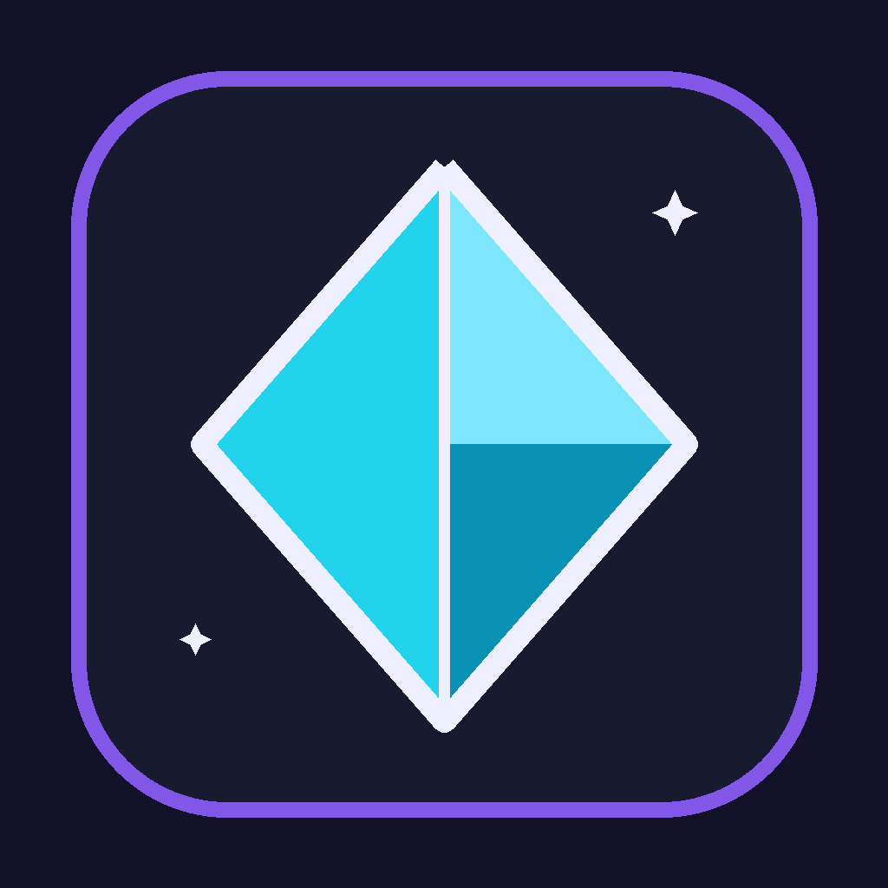

<div align="center">



# CraftLife for Android

**The full CraftLife experience on your phone — offline-first, Minecraft-themed, and synced with the desktop.**

Habits, quests, bosses, pets, money, health, learning, and social features —
a complete client of the CraftLife engine, built thumb-first for Android.

[](https://github.com/Hellowww-02/CraftLife-Android-Version/releases/latest)
[-3DDC84)](https://github.com/Hellowww-02/CraftLife-Android-Version/releases/latest)
[](https://expo.dev/)
[](LICENSE)

[Download](https://github.com/Hellowww-02/CraftLife-Android-Version/releases/latest) ·
[Features](#features) · [Getting started](#getting-started) ·
[Development](#development) · [Docs](#documentation) ·
[Limitations](#honest-limitations)

**Main project:** [Hellowww-02/CraftLife](https://github.com/Hellowww-02/CraftLife) —
desktop app, cloud backend, and shared contracts live there.

</div>

---

## About

CraftLife turns everyday productivity into a role-playing game. This repository
is the **Android** half of that world: a native-feeling client — Expo SDK 57 /
React Native 0.86 — that talks to the CraftLife API, keeps every screen working
offline through a local SQLite cache, and (optionally) syncs everything through
the Supabase cloud so your phone, tablet, and desktop share one life.

- **Offline first** — every screen reads from a local cache; changes queue in an
  outbox and sync when the network returns. Interruptions leave no half-written
  data (part-based snapshots, deterministic retry backoff, a Recovery UI).
- **One tracker, many devices** — link a cloud account to move your tracker
  between devices with explicit conflict resolution (keep local / use cloud).
- **Server-authoritative RPG** — pet gacha odds, pity timers, talents,
  achievements, and boss rewards are validated on the server. The client never
  mints gold or XP.
- **Two languages** — every screen ships in Indonesian and English
  (4,738 strings).
- **Native by default** — bottom navigation, 48 dp touch targets, 12 themes
  (all WCAG-AA contrast), no desktop layouts crammed onto a phone.

## ✨ What's New in v2.0.0 — "Three Platforms, One Life"

| Area | Highlights |
|------|------------|
| 📱 **First public release** | The complete tracker (habits, dailies, quests, sport, health & food, economy, supplies, notes, reminders, calendar, pomodoro) plus the full RPG (pet gacha with pity, talents, achievements, bosses, crafting, Forge, shop) and the social suite (friends, chat, guilds, PvP, leaderboard, Love Space, notifications) |
| 🧩 **Feature menu parity** | The More menu mirrors the desktop sidebar 1:1 — order and labels pinned by tests against the desktop `NavBar._TABS`, so parity is enforced, not claimed |
| ☁️ **Cloud sync (opt-in)** | Row sync + change feed + part-based document snapshots (the old 8 MB ceiling is gone); linked devices share one tracker; FCM push wiring end-to-end (activates when the operator supplies Firebase credentials) |
| 🔌 **Resilience** | Outbox with jittered backoff and dead-letter recovery in Settings, cache caps (2,000/type, 10,000 total), airplane-mode and force-kill tolerant sync |
| 🎨 **Presentation** | Pixel-diamond identity, 12 themes with WCAG-AA contrast on every pair, emoji-first menus, localized screen titles, Indonesian/English throughout |
| 🔒 **Quality** | 293 unit tests, strict TypeScript, version anchors pinned to the desktop release, and a dedicated security/QA pass on the shared backend (see the main repo's `QA_M13.md`) |

## Features

**Tracker** — Habits with true streaks and icons, Dailies with freeze, Quests,
SportTrack with reps and calories, Health & Food (1,074-item bilingual food
database, water goals, BMI), Economy (transactions, debts, savings,
investments, subscriptions), Supplies inventory, Notes, Reminders, Calendar
with Indonesian holidays, and a Pomodoro timer.

**RPG** — Pet gacha (39 pets, six ranks incl. Secret, open odds + pity),
training and active skills, talents, achievements, solo & guild boss battles,
Minecraft-style crafting, the enchant Forge, the Shop, and leaderboards.

**Social** — Friends, hybrid local/cloud chat, online guilds, PvP challenges,
cloud leaderboards, a six-tab Love Space, and a notification center.

**Settings & account** — 12-theme picker, language toggle, cloud link with
device management and conflict resolution, sync queue inspector + Recovery UI,
and an honest offline banner.

## Getting started

### For users

1. Grab the APK from [Releases](https://github.com/Hellowww-02/CraftLife-Android-Version/releases/latest)
   (or join the Play Store internal test).
2. Install it (allow installs from your file manager if asked).
3. For live data, run the CraftLife desktop app (or `python api_server.py`) on
   a machine the phone can reach — without one, the app keeps working offline
   on cached data.

Requirements: Android 7.0+ (API 24).

### For developers

The quick version (full walkthrough, Windows notes, and troubleshooting:
[RUN_ANDROID.md](RUN_ANDROID.md)):

```bash
# 1. build the shared package first (this app consumes its dist/)
cd ../CraftLife
npm install
npm run build:core

# 2. then this project
cd ../CraftLife-Android
npm install
npm run typecheck     # tsc --noEmit → 0 errors
npm test              # vitest
npm run android       # build + install + run (needs an Android SDK + device)
```

The app reads its API address from `.env` (`EXPO_PUBLIC_API_BASE`):
`http://10.0.2.2:8765` for the emulator, your PC's LAN IP for a physical
phone — see [.env.example](.env.example). After every `.env` change:
`npx expo start -c`.

## Architecture

```text
┌──────────────────────────┐        HTTP / JSON         ┌──────────────────────────┐
│  CraftLife API (Python)  │ ◄───────────────────────► │  CraftLife for Android   │
│  desktop app / server    │      port 8765            │  Expo / React Native     │
│  = data + game authority │                           │  = screens + local cache │
└──────────────────────────┘                           └──────────────────────────┘
```

- Screens render from **SQLite cache first**, then refresh from the network.
- Writes go through an **outbox** (`src/sync/`): queued → sent → confirmed, or
  rolled back with a visible `failed` state. Offline creates are blocked
  honestly, not faked.
- Domain types, money formatting, design tokens, and the i18n catalogue come
  from one shared package: `@craftlife/core` (`file:../CraftLife/packages/craftlife-core`) —
  the same implementation the desktop web UI uses.

## Project structure

```text
CraftLife-Android/
├── app/                  expo-router routes
│   ├── _layout.tsx       ThemeProvider + stack; deep link scheme craftlife://
│   ├── (tabs)/           5 bottom tabs: Dashboard · Tasks · Tracker · Social · More
│   ├── more/             24 routed screens (one per feature) + localized headers
│   └── login.tsx
├── src/
│   ├── features/         domain models (menu parity, social, RPG, studio, …)
│   ├── screens/          one module per screen (30 screens)
│   ├── theme/            12 themes from @craftlife/core design tokens
│   ├── sync/             outbox + backoff + recovery (mirrors desktop rules)
│   ├── data/             SQLite cache with caps
│   ├── i18n/             catalogue (id/en, 4,738 keys)
│   ├── api/              platform adapter (no DOM assumptions)
│   └── components/       states + UI primitives (48 dp enforced)
├── tests/                vitest — 293 tests / 18 files
└── android/              generated Gradle project (release signing ready)
```

## Development

| Task | Command |
|------|---------|
| Type check | `npm run typecheck` |
| Unit tests | `npm test` |
| Start Metro | `npx expo start` (press `a` for Android) |
| Debug build | `cd android && .\gradlew.bat :app:assembleDebug` |
| Expo health | `npx expo-doctor` |
| Cross-project gate | `cd ../CraftLife && python scripts/verify_gates.py` (includes `types-mobile`) |

**One rule for every new terminal window:** set `JAVA_HOME` to the JDK 17 that
Gradle auto-downloaded (`.gradle\jdks`) before any Gradle command — the exact
one-liner is in [LANGKAH_CEPAT_ANDROID.md](LANGKAH_CEPAT_ANDROID.md).

## Honest limitations

- **Music** browses playlists and the library; audio files live on the desktop,
  so there is no phone playback yet — no streaming endpoint exists, and we
  don't fake the button.
- **Year Wrapped** has no dedicated Android screen yet.
- **Closed-app push** needs the operator's Firebase credentials; without them
  it is an honest no-op.
- **Device-level verification** (physical-phone TalkBack, cold start, two-device
  social, live cloud spin) is one consolidated maintainer pass, documented in
  the main repository (`VERIFIKASI_M12.md`, `QA_M13.md`).

## Documentation

| Document | Contents |
|----------|----------|
| [RUN_ANDROID.md](RUN_ANDROID.md) | Full walkthrough: toolchain, emulator, physical phone, every failure mode we hit — with fixes |
| [LANGKAH_CEPAT_ANDROID.md](LANGKAH_CEPAT_ANDROID.md) | Short numbered run guide (emulator → physical phone) |
| [RELEASE_NOTES_v2.0.0.md](RELEASE_NOTES_v2.0.0.md) | v2.0.0 release notes |
| [OPERATOR_RELEASE.md](OPERATOR_RELEASE.md) | Release operator runbook for this repository (build → sign → publish → verify → rollback) |
| [.env.example](.env.example) | `EXPO_PUBLIC_API_BASE` for emulator vs physical phone |

## Versioning & relationship to the desktop repo

This folder is intentionally a **sibling** of `CraftLife/` (never inside it):
different toolchain, different store pipeline, different release cadence — and
a path-safe name (no spaces) that Windows tooling needs. Versions are pinned to
the desktop release (K22): `package.json` == `app.json` == `CraftLife/updater.py`
== `CraftLife/web/package.json`, enforced by `tests/version.test.ts` and the
desktop's `version-anchors` gate.

## License

MIT — same as the main project.
